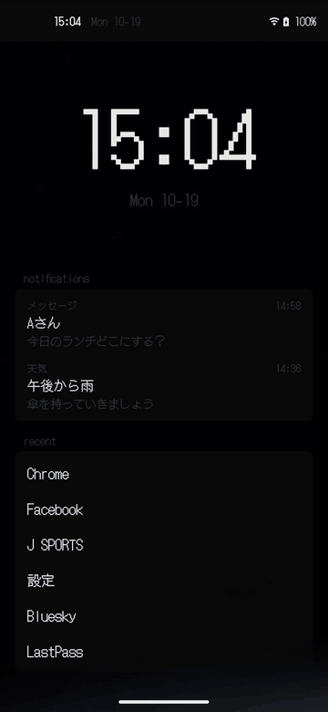

# Simple Launcher

シンプルな Android のホームアプリ。見た目は Omarchy（waybar / walker）寄り。Pixel 4a（Android 13）で動作確認。

<p align="center"></p>

- 上部に waybar 風の一行バー（左に時刻と日付、右にネットワークと電池）
- ホームに届いている通知（最大 4 件）。タップで元のアプリを開き、横スワイプで消す
- ホームは壁紙と最近使ったアプリ（直近 6 時間・最大 6 件）。タップか上スワイプでアプリ検索が出る
- 通知・最近のアプリにはそれぞれ許可が要る（通知へのアクセス、使用状況へのアクセス）。許可していないとホーム下部に案内が出る
- 文字を打つと絞り込み（先頭一致 > 単語頭一致 > 部分一致 > 部分列一致）。Enter か行タップで起動。全角半角、ひらがなカタカナは区別しない（「まっぷ」で マップ）
- 先頭一致・単語頭一致が無いときは、[Jev](https://typesafe.ai/)（TypeSafe）に意味で選ばせて 󰚩 付きで差し込む（「おんがく」で音楽アプリ）。`TYPESAFE_API_KEY` が無ければこの機能は出ない
- ホームボタンで検索やメニューを閉じる
- ホームの空きに大きな時計。何もないところを長押しで設定
- 検索はドラクエのウィンドウ風（黒地に白枠、▶ のカーソル）。設定で walker 風に戻せる
- 何も打っていないときは、アプリを開くのに使った検索語の履歴（最大 10 件）が上に出る。タップで再検索、長押しで履歴から消す
- 行を長押しで「アプリ情報」「アンインストール」（システムアプリはアプリ情報のみ）
- 色は Omarchy のテーマ `colors.toml`、フォントはドット絵の DotGothic16（アイコンだけ UDEV Gothic NF）

## ビルド

Gradle 8.11 なので JDK 21 を使う（JDK 26 は不可）。

```sh
export JAVA_HOME=~/.local/share/mise/installs/java/21
./gradlew assembleDebug
adb install -r app/build/outputs/apk/debug/app-debug.apk
adb shell cmd package set-home-activity dev.polidog.simplelauncher/.LauncherActivity
```

## Jev の API キー

`local.properties`（または環境変数）に入れてからビルドする。キーは APK に入るので、自分の端末で使う前提。

```properties
TYPESAFE_API_KEY=...
```

## デモ表示

README の動画用。debug ビルドだけで効き、通知・検索履歴をダミーに差し替える（本物には触らない）。

```sh
adb shell am start -n dev.polidog.simplelauncher/.LauncherActivity --ez demo true   # 入る
adb shell am start -n dev.polidog.simplelauncher/.LauncherActivity --ez demo false  # 戻る
```

## テーマの差し替え

既定は `app/src/main/assets/colors.toml`（Turbonite）。端末側に置けば再ビルドなしで上書きできる。

```sh
adb push ~/.local/state/omarchy/current/theme/colors.toml \
  /sdcard/Android/data/dev.polidog.simplelauncher/files/colors.toml
adb shell am force-stop dev.polidog.simplelauncher
```

## 構成

| ファイル | 役割 |
| --- | --- |
| `LauncherActivity.kt` | Activity と UI（TopBar、Walker） |
| `Theme.kt` | colors.toml の読み込み |
| `Apps.kt` | 起動可能アプリの列挙、絞り込み、起動 |
| `Status.kt` | 時刻、電池、ネットワークの状態 |
| `Recent.kt` | 使用状況から最近のアプリを拾う |
| `Notices.kt` | 通知を受け取る NotificationListenerService |
| `JevSearch.kt` | Jev で意味からアプリを選ぶ |
| `SearchHistory.kt` | 検索語の履歴 |
| `Settings.kt` | ホームの設定（長押しで出る） |
| `Demo.kt` | README の動画用のデモ表示 |

## ライセンス

MIT（`LICENSE`）。同梱のフォントはどちらも SIL Open Font License 1.1。DotGothic16 は `licenses/DotGothic16-OFL.txt`、UDEV Gothic NF は `licenses/UDEVGothic-LICENSE.txt`。
