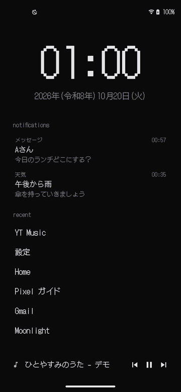
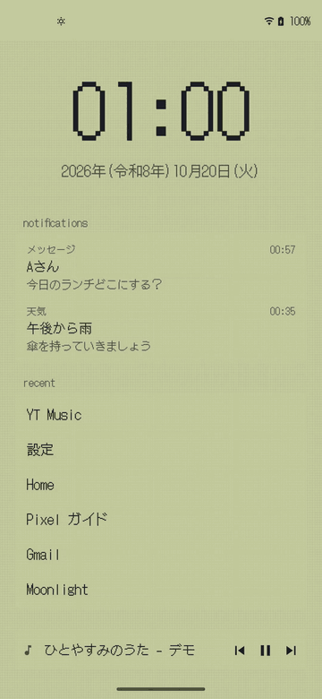

# DotLauncher

A simple Android home app, styled after Omarchy (waybar / walker). Tested on a Pixel 4a (Android 13) and an Xperia XQ-FE44 (Android 16). The UI is in Japanese.

<p align="center">
  
  
</p>
<p align="center">Dark mode on the left, light mode on the right (follows the system setting; can also be toggled from home)</p>

- A waybar-style one-line bar at the top (network and battery on the right). Tap the 󰖔 / 󰖙 at the left end to switch between dark and light mode. “明暗を端末の設定に合わせる” (follow the system dark mode) in settings hands it back to the system
- Notifications on the home screen (up to 4). Tap to open the app that posted it, swipe sideways to dismiss
- Home shows a big clock and recently used apps (last 6 hours, up to 6). Tap or swipe up to open app search
- Notifications and recent apps each need a permission (notification access, usage access). Without them, a hint appears at the bottom of home
- Typing filters apps (prefix > word-start > substring > subsequence). Enter or tap a row to launch. Full-width / half-width and hiragana / katakana are treated as the same (“まっぷ” finds マップ)
- When there is no prefix or word-start match, [Jev](https://typesafe.ai/) (TypeSafe) picks apps by meaning and inserts them marked with 󰚩 (“おんがく” finds music apps). You enter the API key in settings; without one, this feature stays off
- The home button closes search and menus
- A big clock and date (with the Japanese era year) in the empty space of home. Long-press anywhere empty to open settings
- Swipe left on home for a page listing all apps by category (Contacts & social, Work, Maps & travel, Games, …). Each category sits in the same window box as search, packed into 2 columns. Tap to launch, long-press for the menu. Sorting is automatic and uses the category the developer declared. Apps with no category, and apps declared as “Productivity” (too broad — it pulls in browsers and payment apps), are asked to Jev once and the answer is kept on the device (without a key they go to “Other”)
- Search is a game-style window (with a ▶ cursor). Dark mode is Dragon Quest style, white border on black; light mode looks like a Game Boy Pocket LCD. You can switch back to a walker style in settings
- With nothing typed, the history of search terms you used to open apps (up to 10) is shown at the top. Tap to search again, long-press to remove it from history
- Long-press a row for “アプリ情報” (App info) and “アンインストール” (Uninstall) (system apps get App info only)
- Colors come from the Omarchy theme `colors.toml` in dark mode, and from the Game Boy Pocket's 4 shades in light mode (the whole screen becomes an LCD). Both hide the wallpaper and paint the theme's background color. The font is the pixel font DotGothic16 (UDEV Gothic NF for icons only)

## Build

Gradle 8.11 needs JDK 21 (JDK 26 does not work).

```sh
export JAVA_HOME=~/.local/share/mise/installs/java/21
./gradlew assembleDebug
adb install -r app/build/outputs/apk/debug/app-debug.apk
adb shell cmd package set-home-activity jp.polidog.dotlauncher/.LauncherActivity
```

## Jev API key

Long-press anywhere empty on home and paste it into “Jev の API キー” (Jev API key) in settings. The key stays on the device only.

During development, put it in `local.properties` (or an environment variable) and debug builds get it as the default. It never goes into release builds.

```properties
TYPESAFE_API_KEY=...
```

## Release

Play gets a signed AAB. Once you create the upload key, don't lose it (and keep it out of git).

```sh
keytool -genkeypair -v -keystore upload.jks -alias upload -keyalg RSA -keysize 2048 -validity 10000
cat > keystore.properties <<'PROPS'
storeFile=upload.jks
storePassword=...
keyAlias=upload
keyPassword=...
PROPS
./gradlew bundleRelease   # app/build/outputs/bundle/release/app-release.aab
```

Instead of `keystore.properties`, the environment variables `SIGNING_STOREFILE` / `SIGNING_STOREPASSWORD` / `SIGNING_KEYALIAS` / `SIGNING_KEYPASSWORD` work too. Bump `versionCode` in `app/build.gradle.kts` for every release.

The store listing and screenshots are in `fastlane/metadata/android/ja-JP/`, the English listing in `fastlane/metadata/android/en-US/`. The privacy policy is `docs/privacy.md` (English: `docs/privacy-en.md`).

## Demo mode

For the README videos. Works in debug builds only, and swaps notifications, search history and the now-playing track for dummies (the real ones are left alone).

```sh
adb shell am start -n jp.polidog.dotlauncher/.LauncherActivity --ez demo true   # enter
adb shell am start -n jp.polidog.dotlauncher/.LauncherActivity --ez demo false  # leave
```

## Changing the theme

The default is `app/src/main/assets/colors.toml` (Turbonite). Put one on the device to override it without rebuilding.

```sh
adb push ~/.local/state/omarchy/current/theme/colors.toml \
  /sdcard/Android/data/jp.polidog.dotlauncher/files/colors.toml
adb shell am force-stop jp.polidog.dotlauncher
```

## Layout

| File | Role |
| --- | --- |
| `LauncherActivity.kt` | Activity and UI (TopBar, Walker) |
| `Theme.kt` | Loads colors.toml |
| `Apps.kt` | Lists launchable apps, filters, launches |
| `Status.kt` | Time, battery, network state |
| `Recent.kt` | Picks recent apps from usage stats |
| `Notices.kt` | NotificationListenerService that receives notifications |
| `JevSearch.kt` | Uses Jev to pick apps by meaning |
| `SearchHistory.kt` | Search term history |
| `Settings.kt` | Home settings (opened by long-press) |
| `Demo.kt` | Demo mode for the README videos |

## License

MIT (`LICENSE`). Both bundled fonts are under the SIL Open Font License 1.1: DotGothic16 in `licenses/DotGothic16-OFL.txt`, UDEV Gothic NF in `licenses/UDEVGothic-LICENSE.txt`.
